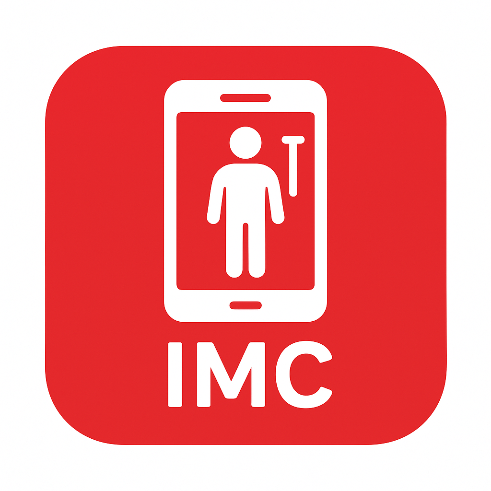

<p align="center">
  
</p>

<h1 align="center">ONEBITHEALTH 2.0</h1>

<p align="center">
  Aplicativo mobile construído com React Native + Expo que calcula o IMC (Índice de Massa Corporal)
  do usuário, permite compartilhar o resultado e mantém um histórico dos cálculos feitos na sessão.
</p>

## Funcionalidades

- Cálculo de IMC a partir da altura e do peso informados pelo usuário.
- Máscaras de entrada para altura (ex. 1.75) e peso (ex. 75.365).
- Validação dos campos, com aviso de erro quando algum valor está vazio ou inválido.
- Compartilhamento do resultado do IMC pelo recurso nativo de compartilhamento do dispositivo
  (Share API do React Native).
- Histórico dos cálculos de IMC realizados durante a sessão, listado em tela.

## Tecnologias

- [React Native](https://reactnative.dev/) 0.79
- [Expo](https://expo.dev/) SDK 53
- [React](https://react.dev/) 19
- TypeScript (configuração base do Expo)
- [EAS Build](https://docs.expo.dev/build/introduction/) para geração de builds (perfis `preview`, `preview2`, `preview3` e `production` em `eas.json`)

## Pré-requisitos

- [Node.js](https://nodejs.org/)
- [Expo CLI](https://docs.expo.dev/get-started/installation/) (executado via `npx`, sem necessidade de instalação global)
- Um emulador Android/iOS configurado ou o app [Expo Go](https://expo.dev/go) no celular para testar via QR code

## Como executar o projeto

1. Clone o repositório:

   ```bash
   git clone https://github.com/DhenzelNxs/ONEBITHEALTH-2.0.git
   cd ONEBITHEALTH-2.0
   ```

2. Instale as dependências:

   ```bash
   npm install
   ```

3. Inicie o projeto com o Expo:

   ```bash
   npm start
   ```

   Outras opções disponíveis no `package.json`:

   ```bash
   npm run android   # abre direto no emulador/dispositivo Android
   npm run ios        # abre direto no simulador iOS
   npm run web        # executa a versão web via react-native-web
   ```

4. Com o Metro Bundler aberto, escaneie o QR code com o app Expo Go ou escolha um emulador/simulador.

## Estrutura do projeto

```text
.
├── App.js                      # Ponto de entrada da aplicação
├── app.json                    # Configuração do Expo (ícones, splash, bundle)
├── eas.json                    # Perfis de build do EAS
├── assets/                     # Ícones, splash e favicon do app
└── src/
    ├── assets/                 # Logo do projeto
    ├── components/
    │   ├── Title/               # Cabeçalho com o nome do app
    │   ├── Input/                # Campo de entrada reutilizável
    │   ├── Home/                 # Composição de Title + Form
    │   └── Form/
    │       └── ResultIMC/        # Exibição e compartilhamento do resultado
    └── utils/
        └── masks.js               # Máscaras de altura e peso
```

## Licença

Este projeto está sob a licença MIT. Veja o arquivo [LICENSE](./LICENSE) para mais detalhes.
